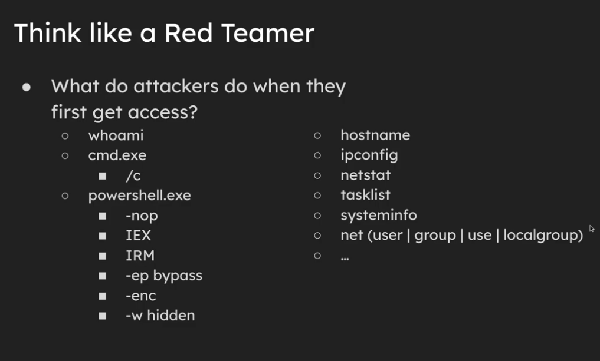

# Windows Blue Team
* Everything in windows is a service
* Services are OS managed programs
* Windows Desktop OS and Windows Server can run the same programs, but some server programs dont run on desktop

## What needs to be done first
1. Install necessary software (sysinternals) using winget
2. Make backups of scored and necessary services
3. Change password of services 

## General Threat Hunting
1. Check Windows Logs
2. Check on users, active users, user changes
3. Check on SSH keys and SSH Config
4. Check running processes

## Record events and take them off server for viewing and notification of suspicious activity
* Use sysmon
* Get a SIEM (Splunk or Wazuh)
* LDAP Object Monitor (See user changes live)
* EDR specialized software
    
## Detect Common First Access Programs
* whoami, etc
* Many of these programs should not have to be run at all


## Sysinternals Suite Provided by Windows
* Use sysmon
* AutoRuns - Finds anything that auto starts and has some advanced auto features like uploading to VirusTotal

## Powershell Logging
Enable powershell logging to record what has been allowed by powershell
* Script Block Logging - Will record blocks of powershell code as they are evaluated (de-obfuscate obfuscated code)
* Transcription - Will record the exact input into powershell that the user would see

## Common windows CLI commands
### Command Prompt
```
query user # Display a list of users

```
### Powershell
```
Get-LocalUser # Get all local users
```
```
Get-ADUser -Filter * # Get all active directory users
```
    
## SMB
* Disable SMB null and anonymous authentication
    - This is something that allows somebody to login without username and password and is abused frequently
    - Possibly keep it enabled and automatically block IPs that connect via it
    
## SSH
* Routinely check what SSH public keys are being stored and accepted
* Routinely check SSH configuration

## Dictionary
* Endpoint: Any decive that connects to a network and can send, recieve, or process data.
* Sysmon: A windows service thats logs system activity to the Windows Event Log
* SIEM: Security Information and Event Management
* XDR: Extended Detection and Response
* Directory Server: Centralized databases that store and manage information about users, devices, and network resources.
    - Active Directory: Windows server version of a directory server
* EDR: Endpoint and Detection Response
* Beacon: A type of malware that sends information from a compromised system to the Command and Control Center to signal that the system has been comrpomised
    

## Recommended Tools
* [Wazuh | SIEM](https://wazuh.com/) + [Detection Rules](https://github.com/socfortress/Wazuh-Rules/blob/main/Windows%20Powershell/100535-win_powershell_rules.xml)
* [LDAP Object Monitor | Active Directory Monitor](https://github.com/p0dalirius/LDAPmonitor)
* [BlueSpawn | EDR tailored software](https://github.com/ION28/BLUESPAWN)
* [AtomicRedTeam | Simulate attacks to test endpoint](https://www.atomicredteam.io/)
* Sysinternals 
    * Tcpview - View processes with active network ports (Useful for finding beacons)
    * Procexp - View ALL processes (Use for finding a running malware)
    * Procmon - View processes file operations, thread operations, and regedits (Kind of a large list, may not be very useful)
* Group Policy Editor
* Registry Editor - View the registry (Not very useful for search, better to use logs)
* Task Scheduler - View processes that are scheduled
* Computer Management - All in one view for managing the server. View users, groups, etc.
* Server Manager - All in one view for server features. View services and events.
